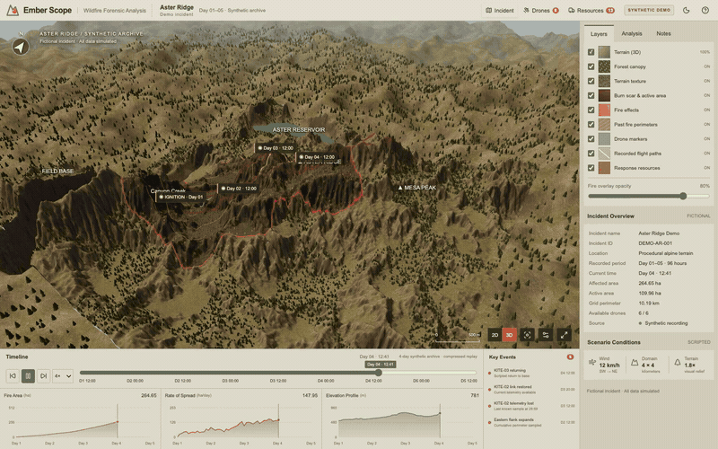

# Ember Scope

**Visualización interactiva de incendios forestales, de código abierto, con React, TypeScript y Three.js.**

[English](../../README.md) · [简体中文](README.zh-CN.md) · [Español](README.es.md) · [Français](README.fr.md) · [日本語](README.ja.md)

Explora un incidente ficticio en una región montañosa, desde la primera ignición hasta un archivo de cuatro días. Desplaza la línea de tiempo, inspecciona la cámara simulada de un dron, alterna entre 2D y 3D y sigue las descargas programadas de las aeronaves. El terreno, la telemetría y los gráficos comparten un único tiempo determinista.

> **DEMOSTRACIÓN SINTÉTICA:** El terreno, los incidentes, la telemetría, las imágenes de sensores y las operaciones son simulados. No es una herramienta de vigilancia en tiempo real, predicción física, coordinación de rescates ni toma de decisiones de emergencia.

## Vídeo de presentación

[](https://github.com/JesseQin123/ember-scope/blob/main/docs/media/demo.mp4)

[Ver o descargar el MP4](https://github.com/JesseQin123/ember-scope/blob/main/docs/media/demo.mp4) · [Introducción en inglés y guía de grabación](../VIDEO.md)

El vídeo muestra esta aplicación en funcionamiento: evolución del incendio, vistas EO/IR/Thermal, una descarga aérea y el mapa topográfico. No contiene imágenes del vídeo original de FireTrace.

**Introducción:** Descubre Ember Scope, una visualización interactiva de incendios forestales de código abierto. Recorre un paisaje ficticio, reproduce cuatro días de evolución, inspecciona seis drones simulados y sigue trece recursos de respuesta. Una sola línea de tiempo sincroniza cada escena y gráfico. Todo es sintético, reproducible y ejecutable en tu equipo.

## Funciones

- **Incident:** terreno erosionado, bosque, embalse y río conectados, perímetros irregulares, áreas quemadas, fechas, capas, opacidad y tres gráficos vinculados.
- **Drones:** seis drones seleccionables, batería/altitud/estado, trayectorias válidas, última telemetría congelada, cámara de la misma escena, calor relativo IR/Thermal, zoom y seguimiento.
- **Resources:** trece aeronaves, vehículos y equipos; geometría procedural diferenciada, vistas de seguimiento/cabina, cargas programadas, partículas de descarga y depósitos que se reconstruyen al retroceder.
- **Reproducción:** pausa, búsqueda, reinicio, velocidades, teclado, 2D/3D, temas claro/oscuro, gráficos reducidos y alternativa cuando WebGL no está disponible.

La interfaz está en inglés. Las cinco versiones del README son traducciones de la documentación, no de la interfaz.

## Ejecutar localmente

Requiere Node.js 22.12+, npm y un navegador con WebGL2.

```sh
git clone https://github.com/JesseQin123/ember-scope.git
cd ember-scope
npm ci
npm run dev
```

Abre **http://127.0.0.1:5173/**. No hacen falta claves API, servidor de datos ni mapas externos.

```sh
npm test
npm run build
npm run preview
```

La compilación estática se previsualiza en http://127.0.0.1:4173/. Para las pruebas de navegador, instala Google Chrome, deja activo el servidor de desarrollo y ejecuta `npm run test:e2e` en otra terminal. `npm run verify` genera capturas y mediciones. Usa `EMBER_BASE_URL` para un puerto diferente.

## Controles

Arrastra para orbitar, arrastra con el botón derecho para desplazar y usa la rueda para acercar. La línea de tiempo y las fechas permiten saltar. Espacio reproduce o pausa fuera de los campos de entrada. Las flechas avanzan 16 minutos del archivo; Shift + flecha, 96. Selecciona entidades en la lista o en el mapa. Reset view solo cambia la cámara. La reproducción se pausa al ocultar la página.

## Determinismo, pruebas y límites

Un único valor entero de 0 a 3600 controla el archivo. Cada unidad equivale a 96 segundos archivados: del día ficticio 01 a las 12:00 al día 05 a las 12:00. A 1×, un segundo real avanza 16 minutos del archivo; a 4×, el recorrido dura unos 90 segundos. El fuego procede de una cuadrícula fija de 128×128; el agua no arde. Retroceder reconstruye el mismo estado. La telemetría representa instantáneas comprimidas, no vuelos físicos de cuatro días.

La versión inicial supera 23 pruebas de simulación/estado y 14 de navegador. Consulta las [reglas](../SCENARIO.md) y la [validación](../VALIDATION.md). Los modelos son estilizados, el humo usa partículas, los sensores muestran calor relativo y los depósitos no extinguen el incendio programado. No se afirma una reproducción idéntica píxel a píxel.

## Inspiración, contribuciones y licencia

Inspirado en la [demostración FireTrace de Dilum Sanjaya](https://x.com/DilumSanjaya/status/2108241054298415258). Es una implementación independiente, sin afiliación ni respaldo. No incluye código, marca, vídeo, capturas, mapas ni modelos originales. La [procedencia de los recursos generados](../ASSETS.md) documenta las texturas y el humo.

Se agradecen incidencias, traducciones y PR; consulta [CONTRIBUTING](../../CONTRIBUTING.md). Código, datos originales y recursos del proyecto se ofrecen bajo [MIT](../../LICENSE), en la medida de los derechos que se posean. Las dependencias conservan sus licencias; no se reclaman derechos exclusivos sobre las imágenes generadas por IA. Consulta [LICENSES](../../LICENSES.md).
